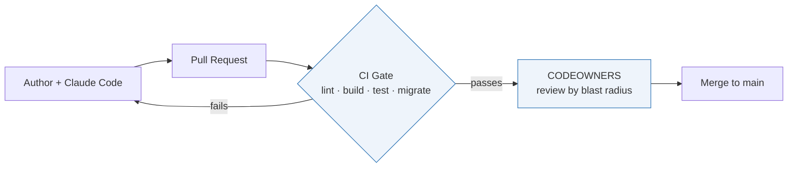

# AI-Delivery Guardrails

**A reference implementation of a safe AI-assisted delivery pipeline — how to let more people ship code with AI without raising your incident rate.**

This repository is the artifact, not the app inside it. The app is a deliberately boring task API. What is worth looking at is everything *around* it: the checks, the review routing, and the permission boundaries that make AI-authored code safe to merge.

---

## The problem

AI coding tools make *writing* code cheap. That doesn't remove the bottleneck — it moves it to *verifying* code. Teams that add AI authors without first building the verification layer ship more code **and** cause more incidents, because every new author lands on the same overloaded reviewers.

The fix isn't "more review." It's a system where automated checks catch most problems before a human looks, and human attention is reserved for the changes that actually carry risk. This repo is a small, working version of that system.

## The principle

> **Match a change's blast radius to the author's context.**

A typo fix and a database migration are not the same risk, so they shouldn't follow the same path. Low-risk changes are cheap to verify and safe to let more people make. High-risk changes stay with the people who understand the consequences. Every guardrail here exists to enforce that one idea.

## The flow



The agent never holds production credentials. The only database anything here connects to is a development or throwaway instance — so no AI-authored change can reach real data, by construction.

## Tour of the guardrails

| File | What it is | What it prevents |
|------|------------|------------------|
| `.claude/settings.json` | The agent's allow / ask / deny boundary | Reading secrets, force-pushing, destructive or networked commands — denials hold even in bypass mode |
| `CLAUDE.md` | House rules + the canonical commands | The agent inventing its own workflow, editing applied migrations, or touching production |
| `.github/workflows/ci.yml` | The automated gate | Anything that fails lint, build, tests, or a clean migration from merging |
| `CODEOWNERS` | Review routing by path | High-risk paths (schema, DB, pipeline) merging without an owner's review |
| `migrations/` + `scripts/migrate.js` | Forward-only migrations, proven on a throwaway DB | Schema changes reaching production untested or out of order |
| `.env.example` / `.gitignore` | The secrets contract | Credentials ever entering the repo |

## The demo app

A task API with create / read / list / delete and one table. It's intentionally unremarkable so the governance is unmistakably the focus. The structure does carry one teaching point: pure logic (`src/tasks/validate.js`) is split from I/O so the lowest-risk changes are also the easiest to test.

## Proof it works

Browse the **pull requests** and **Actions** tabs. Each feature here was added through the pipeline above: opened as a PR, gated by CI, reviewed, merged. The history is the evidence that this is a working system rather than a static template.

## Adopting this in your organization

The same shape drops onto any stack — define your commands once and the gate, the agent config, and the house rules all reference them. **You add the six guardrail files *around* your existing code; you don't change the application's design to adopt this.**

Once the net is in place, a non-engineer can ship a safe-tier change without reading the code: describe the change in plain English to Claude Code, which follows `CLAUDE.md`, runs the tests, and opens a PR; CI gates it and `CODEOWNERS` routes review by blast radius. See **[docs/ADOPTION.md](docs/ADOPTION.md)** for how that works and the phased rollout; `docs/PATTERN.md` explains the blast-radius model in full.

## Quickstart

```bash
npm install            # generates package-lock.json — commit it
cp .env.example .env   # point DATABASE_URL at a local/dev Postgres
npm run migrate
npm test
npm run dev            # http://localhost:3000/health
```

## Notes & limitations

- The GitHub-specific pieces (the `@claude` action, hosted PR review) move fast; treat the docs as the source of truth for current details. The stack-agnostic spine — commands defined once, CI as the gate, the deny-list as the real boundary, the database isolated — is the stable part.
- The CI-trigger caveat in `.github/workflows/claude.yml` is the single easiest thing to get wrong: confirm your gate actually runs on AI-authored PRs.
